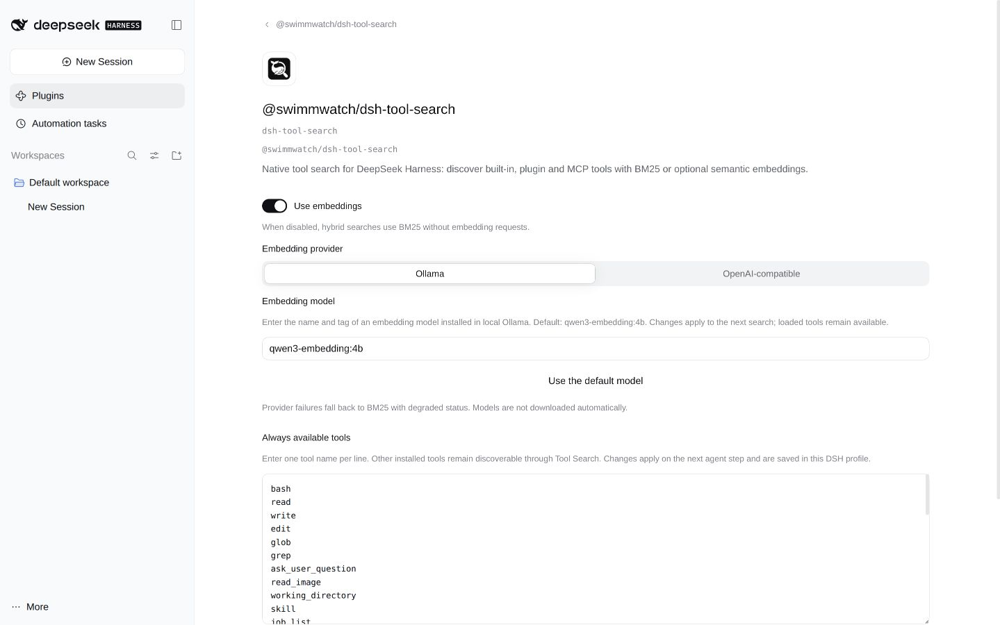

# DSH Tool Search


[](https://github.com/swimmwatch/dsh-tool-search/actions/workflows/ci.yml)

A native [DeepSeek Harness](https://github.com/deepseek-ai/deepseek-harness)
(DSH) plugin that finds tools when an AI agent needs them.
It searches built-in DSH tools, plugin tools and MCP tools, then exposes the
selected schemas on the next agent step. Search does not execute tools or
change their permissions.

Keep a small, configurable set of tools always available; discover the rest with
`tool_search` and remove unused schemas with `tool_unload`. Each agent has its
own set of up to 16 additional tools. Native and PTC presets are supported.

Use local **BM25 tool search**, or add **semantic search** through Ollama or an
OpenAI-compatible embeddings API. It works with Model Context Protocol (MCP)
tools alongside native tools, without running another MCP server.

<picture>
  <source media="(prefers-color-scheme: dark)" srcset="assets/settings-dark.png">
  
</picture>

## Requirements

- DeepSeek Harness **0.2.1-rc.2** and **Node.js 24**.
- A working DSH profile; the examples below use `web`.
- Embeddings are optional. Search works without Ollama or an API key when
  **Use embeddings** is off.

The npm package is **`@swimmwatch/dsh-tool-search`**. The unscoped
`dsh-tool-search` package belongs to another project.

## Install

Once a stable release is published:

```sh
dsh plugin --profile web add @swimmwatch/dsh-tool-search@latest
```

To try a published release candidate:

```sh
dsh plugin --profile web add @swimmwatch/dsh-tool-search@next
```

For reproducibility, replace the tag with an exact published version. You can
also download a prebuilt `.tgz` and `SHA256SUMS` from
[GitHub Releases](https://github.com/swimmwatch/dsh-tool-search/releases), verify
its SHA-256, and pass its absolute path to the same installation command.
Follow DSH's reload/restart message. Do not use `npm install -g`: DSH activates
plugins through profile bundles, not npm's global package directory.

### Updating an earlier local installation

Back up the profile manifest, lockfile and Cordis patch first. Remove the old
local `dsh-tool-search` bundle through `dsh plugin --profile web remove`, then
add the scoped package. Preserve the `dsh-tool-search` row ID and its config;
replace any old explicit package-name override with the scoped name. Do not
activate both packages: they register the same two tools. Credentials and the
vector cache stay in the same locations. See [the release and migration guide](docs/releases.md).

## Use

The agent first searches for a capability:

```json
{ "query": "workflow", "limit": 1, "mode": "bm25" }
```

Pass this to `tool_search`. After it returns, the next model step receives the
original `workflow` schema. The agent can then call `workflow` with the arguments
required by that schema and the usual DSH permission checks.

```text
Always-available tools + tool_search
                |
          search a capability
                |
       select and load its schema
                |
      next step: call through DSH
                |
        tool_unload when finished
```

`tool_search` defaults to hybrid search with three results (maximum five).
Use an exact tool name or a focused task description. An empty query returns a
compact inventory. `tool_unload({"names":["workflow"]})` removes a discovered
schema; `tool_unload({})` removes all additionally loaded schemas. Tools configured
as always available cannot be unloaded.

## Configure

Open **Plugins → @swimmwatch/dsh-tool-search → dsh-tool-search → Configure**.

- **Always available tools:** one tool name per line. The default includes 39
  tools for files, workflows, background jobs, scheduling, goals and agents.
  `tool_search` and `tool_unload` always remain available.
- **Use embeddings:** turn off for fully local BM25 search, with no embedding
  network requests. This intentional mode is not reported as degraded.
- **Ollama:** default provider, model `qwen3-embedding:4b`. Install your selected
  model yourself; the plugin never downloads models.
- **OpenAI-compatible:** set model, API base URL and credential reference.
  Defaults are `text-embedding-3-small` and `https://api.openai.com/v1`.
  Save keys through the DSH credential control; stored plaintext is never shown.
  This control requires a writable DSH credential service. If it is unavailable,
  supply `DSH_TOOL_SEARCH_OPENAI_API_KEY` in the DSH process environment instead.

Settings apply to the next search. An in-flight search retains its original
settings, and switching providers preserves each provider's configuration.
Saving settings alone never calls an embeddings API.

## Privacy and limitations

An enabled remote embedding provider receives the query and prepared tool
descriptions. BM25 and pattern search are local. Exact-name searches do not
request embeddings. Provider errors fall back to BM25 with `degraded: true`.

The vector cache stores hashes and vectors under `$DSH_HOME/cache/dsh-tool-search`,
not queries, raw catalogs or keys. Search preserves registry scope and DSH access
checks. Unloading schemas does not remove earlier conversation messages, skill
catalogs or tool results. Smaller schema payloads do not by themselves prove
lower total task cost; include caching and extra search calls in comparisons.

See [tool/provider details](docs/reference.md), the
[public contract](docs/public-contract.md) and [benchmark methodology](benchmarks/README.md).

## Update or remove

Update with the installation command and an explicit version or release tag.
To remove the plugin:

```sh
dsh plugin --profile web remove @swimmwatch/dsh-tool-search
```

Follow DSH's restart instructions. Disabling/removing the plugin unregisters its
tools and filtering; the underlying DSH/plugin/MCP tools remain registered.

## Development and releases

```sh
npm ci
npm run check
npm run package:verify
npm run benchmark
```

CI also checks installation, repository policy, secrets, dependency security and
CodeQL. Releases use SemVer, Keep a Changelog and Conventional Commits. Candidates
use `next`; stable versions use `latest`. See [CONTRIBUTING.md](CONTRIBUTING.md),
[the release procedure](docs/releases.md) and [SECURITY.md](SECURITY.md).

Licensed under [Apache-2.0](LICENSE). [NOTICE](NOTICE) and [PROVENANCE.json](PROVENANCE.json)
record the origin of incorporated code.
